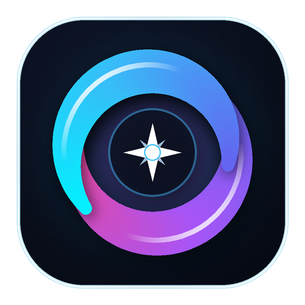

# ⚡ Focus Flow • Pomodoro 50/10 Pro

<p align="center">
  
</p>

<p align="center">
  <strong>Ứng dụng Quản Trị Thời Gian Học Tập Sâu & Bảo Vệ Mắt (Aesthetic Lofi) cho Windows</strong><br>
  <em>Tích hợp Mini HUD ghim nổi góc màn hình, 8 không gian nghệ thuật 60 FPS, Nhạc nền Lofi không quảng cáo & Khóa xao nhãng thông minh.</em>
</p>

<p align="center">
  
  
  
  
</p>

---

## 🌟 ĐIỂM NỔI BẬT ĐỘC BẢN

- 🌸 **Mini HUD Ghim Nổi Góc Màn Hình (Floating Bar - Phím <kbd>F8</kbd>):**
  - Kích thước siêu nhỏ gọn (320x64px), tự do kéo thả, luôn ghim nổi (Always-On-Top) trên mọi cửa sổ làm việc (VS Code, PDF, Word, Game).
  - Tích hợp **8 phong cách nghệ thuật sống động 60 FPS**: *Biển Sao Đêm (Twilight), Đèn Trời (Lanterns), Hoa Anh Đào (Sakura), Bếp Lửa (Fireplace), Mưa Laser (Cyber), Cực Quang (Aurora), Bão Tuyết (Snow), Vũ Trụ 8-Bit (Pixel).*
  - **Đổi hiệu ứng động 1-Click**: Nhấp vào biểu tượng ngôi sao <kbd>★</kbd> trên Mini HUD để đổi ngay hiệu ứng hạt mà không cần mở cửa sổ to.
- 🎨 **Bộ Sưu Tập Giao Diện Đa Sắc (Theme Gallery):**
  - Bấm nút `☕ Lofi` trên thanh tiêu đề để mở bộ sưu tập 8 chủ đề tuyển chọn kết hợp 7 màu nhấn cá tính.
- 🎵 **Âm Thanh Lofi Thư Giãn Tích Hợp (Offline 100%):**
  - Tiếng **Mưa rơi rả rích, Đĩa than vinyl cổ điển, Lò sưởi ấm cúng**.
  - Nghe trực tiếp từ app, **tuyệt đối không cần mở tab YouTube** để không bị quảng cáo làm ngắt quãng mạch tập trung.
- ⏱️ **Nhịp Điệu Khoa Học 50/10 & Bảo Vệ Mắt Y Khoa (Eye Rest 20-20-20):**
  - **Tập Trung Học Tập (50 phút):** Đi kèm đĩa đồng hồ Swiss Dial, bảng mục tiêu bước nhỏ và hàng rào kỷ luật thép.
  - **Nghỉ Mắt (10 phút):** Hướng dẫn quy tắc y khoa 20-20-20, chớp mắt uống nước và giãn cơ cổ vai gáy.
- 💡 **Sổ Bắt Ý Tưởng Tức Thời (<kbd>Ctrl + Shift + D</kbd>):**
  - Đang tập trung mà nảy ra ý nghĩ hay việc cần làm? Bấm phím tắt mở sổ ghi nhanh trong 2 giây rồi quay lại bài học, không bị đứt mạch tư duy.
- 🎓 **Hỗ Trợ Học Trực Tuyến YouTube / Facebook:**
  - Nút gạt 1-click cho phép xem bài giảng, livestream khóa học trên YouTube/FB mà không bị hệ thống chặn nhầm.

---

## 📖 CẨM NANG HƯỚNG DẪN SỬ DỤNG NHANH

> 📘 *Bạn muốn đọc hướng dẫn chi tiết từng tính năng kèm hình ảnh và phân tích khoa học? Hãy xem file [docs/Huong_Dan_Su_Dung.md](docs/Huong_Dan_Su_Dung.md).*

### 1. Cách dùng Mini HUD ghim nổi
- **Bật / Tắt Mini HUD**: Nhấn phím <kbd>F8</kbd> (hoặc <kbd>Ctrl + M</kbd>), hoặc nhấp đúp vào thanh tiêu đề trên cùng.
- **Kéo thả vị trí**: Nhấn giữ chuột trái vào khoảng trống của thanh Mini HUD và kéo đến góc màn hình mong muốn.
- **Đổi hiệu ứng nền**: Bấm vào nút <kbd>★</kbd> trên thanh Mini HUD để chuyển luân phiên 8 hiệu ứng động 60 FPS.
- **Phóng to lại**: Nhấp đúp vào thanh Mini HUD hoặc ấn lại <kbd>F8</kbd>.

### 2. Tab Cài Đặt (Settings) có những gì và nên cài như thế nào?
Vào Tab **`Cài Đặt`** ở thanh điều hướng:
| Mục cài đặt | Tùy chọn có sẵn | Lời khuyên thiết lập tối ưu |
| :--- | :--- | :--- |
| **Chu kỳ học & nghỉ** | `50/10'`, `25/5'`, `90/20'` | **Nên chọn `50/10'`** cho học đại học, ôn thi, viết code dài. Chọn `25/5'` nếu xử lý việc ngắn. |
| **Mục tiêu ca trong ngày** | 2 ca, 3 ca, 4 ca, Vô hạn | **Nên chọn `3 ca` hoặc `4 ca`** (tương đương 2.5 - 3.5 giờ học sâu tinh khiết mỗi ngày). |
| **Cơ chế ép buộc giờ nghỉ** | Rèm đen (Overlay), Khóa máy (Lock), Tắt màn hình | **Nên chọn `Rèm Đen Phủ Màn Hình`** (che dịu mắt đếm ngược 10 phút, có nút xin gia hạn nếu cần lưu bài). |
| **Hàng rào trì hoãn 3s** | Bật / Tắt | **NÊN BẬT**: Khựng lại 3s để chặn thói quen lướt web vô thức, có nút "Tôi đang học bài" nếu xem YouTube giảng bài. |
| **Bảo vệ thị giác 20-20-20** | Bật / Tắt | **NÊN BẬT**: Nhắc nhìn xa 6 mét trong 20s và chớp mắt uống nước khi đến giờ nghỉ. |
| **Nhắc nhở phút 25 & 48** | Bật / Tắt | **NÊN BẬT**: Phút 25 kiểm tra tiến độ, phút 48 đóng gói và lưu mã nguồn/tài liệu. |
| **Âm lượng chuông báo** | Thanh trượt 0 - 100% | **Nên đặt 70% - 80%**, bấm nút "Nghe thử" để kiểm tra độ to vừa tai. |

### 3. Xem phim & Anime không bị chặn (<kbd>F9</kbd>)
- Bấm phím <kbd>F9</kbd> để mở menu **Movie Timer**: Chọn 45' (Anime), 90' (Phim vừa) hoặc 120' (Phim bom tấn). Hệ thống sẽ tạm dừng tính năng chặn và chuông sẽ báo khi phim kết thúc.

### 4. Bảng phím tắt tiện ích
- <kbd>Space</kbd>: Bắt đầu / Tạm dừng ca học.
- <kbd>F8</kbd> hoặc <kbd>Ctrl + M</kbd>: Bật / Tắt thanh Mini HUD ghim nổi.
- <kbd>Ctrl + Shift + D</kbd>: Mở nhanh Sổ cất ý tưởng bất chợt (Brain Dump).
- <kbd>F9</kbd>: Mở menu Hẹn giờ xem phim / Anime.
- <kbd>Enter</kbd>: Tạo nhanh mục tiêu bước nhỏ tiếp theo trong danh sách.

---

## 🚀 TẢI VỀ DÙNG NGAY (WINDOWS PORTABLE - KHÔNG CẦN CÀI PYTHON)

1. Vào mục [**Releases**](https://github.com/baro-hcmut/focus_flow/releases).
2. Tải tệp nén **`Focus_Flow_v1.0_Windows.zip`** về máy.
3. Giải nén tệp zip ➔ Nhấp đúp vào **`Focus Flow.exe`** (hoặc `Chay_Focus_Flow.bat`) là dùng ngay!

> 💡 **Mẹo:** Ứng dụng đã được tích hợp sẵn 3 tầng bảo vệ chống lỗi .NET và tự động bỏ qua cảnh báo bảo mật Windows khi tải từ mạng về.

---

## 🛠️ CHẠY TỪ MÃ NGUỒN (DEVELOPER)

Nếu bạn là lập trình viên muốn tự phát triển thêm:

```bash
# 1. Clone repository
git clone https://github.com/baro-hcmut/focus_flow.git
cd focus_flow

# 2. Cài đặt các thư viện cần thiết
pip install -r requirements.txt

# 3. Khởi chạy ứng dụng
python main.py
```

Để tự đóng gói thành file `.exe`:
```bash
# Chạy script đóng gói tự động:
scripts\Build_FocusFlow.bat
```

---

## 📄 GIẤY PHÉP (LICENSE)
Dự án được phân phối dưới giấy phép [**MIT License**](LICENSE). Hoàn toàn miễn phí, mã nguồn mở cho mục đích học tập và làm việc.
